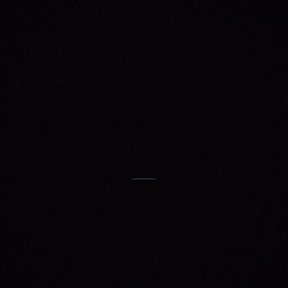

# CATANA — an AI creative director for Claude

Give Claude an idea ("a luxury cinematic commercial for a modern villa in Abu Dhabi") and CATANA turns it into a
production:
- creative concept and visual direction
- storyboard and shot list
- camera movements and lighting
- image and video prompts that pass a quality check
- sound design with a free voiceover
- the edit sequence

It then makes the production with whatever is really available:
- the generators connected to Claude (Higgsfield, Runway, ElevenLabs);
- your own free, local **VoiceStudio** for voice;
- CATANA's code-rendered **motion engine** for beat-cut motion graphics films.

When none of those can run it, you get a ready-to-use prompt pack.

It never pretends: nothing is called "generated" without a real file or URL, paid generators are always quoted and
approved first, and sound stays free.

## What's inside

| | |
|---|---|
| **AI Director** | idea → concept → beats → shots sized to the length and each camera move → keyframe and video prompts → VO plan → edit list → `storyboard.md` |
| **Studios** | UGC, Advertising, Cinematic, Product, Architecture, Social (+ faceless), Character |
| **Prompt engine** | plain language → a 13-field spec (objective, subject, environment, composition, camera, lens, lighting, materials, motion, style, colour grade, technical, negatives) → provider-ready prompt; 11 domain presets |
| **Camera library** | 27 moves, each with definition, best use, camera and subject behaviour, example prompt, common mistakes and combinations; conflicts and minimum durations are checked |
| **Quality control** | a validation checklist with a fix for every issue; shot and sequence continuity (characters, light, grade, ratio, pacing) |
| **Providers** | capability manifest, free-first cost policy (free-only for audio), retry and fallback, an honest run log |
| **VoiceStudio** | client for the local VoiceStudio app: voiceover, voices, voice design, fitting lines to their slots, mixed into films with ducking |
| **Motion engine** | the original Katana-style engine: beat-locked hard cuts, slam type, slash transitions and post FX, now at 16:9, 9:16, 1:1 or 4:5 |
| **17 slash commands** | `/catana:hero-shot`, `/catana:ugc-video`, `/catana:video-director`, `/catana:storyboard`, `/catana:architecture-film`, … ([all commands](docs/COMMANDS.md)) |

## Samples

**"CATANA 2.0": one scene file, three formats.** 15 s, rendered locally by the motion engine at 16:9, 9:16 and 1:1
(SFX only, no credits used). Source and render steps: [examples/catana-2-promo](examples/catana-2-promo/).

| 16:9 | 9:16 | 1:1 |
|---|---|---|
| [](media/catana-2-sample-16x9.mp4) | [](media/catana-2-sample-9x16.mp4) | [](media/catana-2-sample-1x1.mp4) |

**AI Director production pack.** "A luxury cinematic commercial for a modern villa in Abu Dhabi", 40 s. Includes the
concept, continuity bible, 8 shots with keyframe and video prompts, a dusk transition, VO and an edit list. All shots
grade A. See [examples/villa-commercial/storyboard.md](examples/villa-commercial/storyboard.md).

## Demo (motion engine, v1)

Two test films made with the motion engine from a one-paragraph brief (the brands are fictional). The GIFs are silent
previews; click through for the MP4 with sound.

| Inkwell: 20 s app promo, cut to a 120 BPM track | Ledgerly: 15 s landing-page intro, no music given (SFX only) |
|---|---|
| [](media/demo-inkwell-20s.mp4) | [](media/demo-ledgerly-15s.mp4) |
| [▶ MP4 with sound](media/demo-inkwell-20s.mp4) | [▶ MP4 with sound](media/demo-ledgerly-15s.mp4) |

## Install

**Claude Code plugin (all slash commands):**
```bash
claude plugin marketplace add souhaibsmadi42/catana-skill
```
```bash
claude plugin install catana@catana
```
In a session you can run `/plugin marketplace add souhaibsmadi42/catana-skill` and then `/plugin install catana@catana` instead.
Commands appear as `/catana:<command>`.

**Plain skill (no extra commands, everything else works):**
```bash
git clone https://github.com/souhaibsmadi42/catana-skill.git ~/.claude/skills/catana
```
(Windows: `%USERPROFILE%\.claude\skills\catana`.) Restart Claude Code.

**Claude.ai / Claude desktop:** zip this folder and upload it under Settings → Capabilities → Skills. Then just describe
the job, or name the mode in words ("catana storyboard: …").

## Use it

> /catana:video-director luxury cinematic commercial for a modern villa in Abu Dhabi, 40 s

> /catana:ugc-video vitamin C serum, TikTok, 25 s, skincare creator, hook: dark spots in two weeks

> /catana:hero-shot matte black perfume bottle on wet basalt, 4:5

> /catana:motion-film 30 s katana promo for my app, use song.wav, vertical

…or ask in plain words; the skill routes itself. The engine CLI also works on its own:
```bash
python scripts/catana.py enhance "a vintage red Porsche 911 on a coastal cliff road, aerial reveal, 8 seconds"
```

## Free voice with VoiceStudio

If the VoiceStudio app is running on your computer (default `http://127.0.0.1:3900`), CATANA uses it for every
voiceover: `catana.py voice speak …`, `voice plan …`. Set `CATANA_VOICE_STUDIO_URL` for another address, and
`OMNIVOICE_API_KEY` if it isn't on localhost. VoiceStudio has to be reachable from where Claude runs: a cloud session
can't reach your laptop's localhost, so there CATANA delivers the VO script instead. Sound effects come from CATANA's
procedural mixer and music from your own track, so sound stays free.

## Requirements

- **Planning, prompts, QC, Director, providers:** Python 3.9+ only (standard library).
- **Generation:** the connectors you've added to Claude (Higgsfield / Runway / ElevenLabs), with your own credits.
- **Motion engine** (only when rendering a film):
  - Node.js 18+ and npm
  - Python 3 with `numpy scipy soundfile pyloudnorm pillow`
  - Chrome, Chromium or Edge
  - `ffmpeg-static`, added by `npm install`

## Docs

[WORKFLOWS](docs/WORKFLOWS.md) · [COMMANDS](docs/COMMANDS.md) · [IMAGE_GENERATION](docs/IMAGE_GENERATION.md) ·
[VIDEO_GENERATION](docs/VIDEO_GENERATION.md) · [CAMERA_MOVEMENTS](docs/CAMERA_MOVEMENTS.md) ·
[PROMPT_ENGINEERING](docs/PROMPT_ENGINEERING.md) · [PROVIDERS](docs/PROVIDERS.md) · [ARCHITECTURE](docs/ARCHITECTURE.md) ·
[EXAMPLES](docs/EXAMPLES.md) · [TROUBLESHOOTING](docs/TROUBLESHOOTING.md) · [TEST_REPORT](docs/TEST_REPORT.md) ·
[CHANGELOG](CHANGELOG.md)

## Tests

```bash
python -m unittest discover tests
```
Add `CATANA_INTEGRATION=1` to also render motion-engine stills in three formats (needs Node, Chrome and npm).

## Good to know

- **Honest output.** "Generated" only means a provider returned an asset. Everything else is labelled a prompt pack.
- **Your money.** Paid connectors are always quoted first and run only after your OK. A failed paid generation is never
  silently retried on another paid service.
- **Original work.** CATANA reproduces publicly known creative workflows and styles. It does not copy any platform's
  proprietary code, prompts or assets, and it won't imitate real people without their consent.
- **Bring your own music.** The motion engine cuts to a track you have rights to; without one it makes an SFX-only cut.

## License

MIT, see [LICENSE](LICENSE). The fonts (Anton, Inter, JetBrains Mono) are installed from npm under the SIL Open Font
License and are not bundled here.
